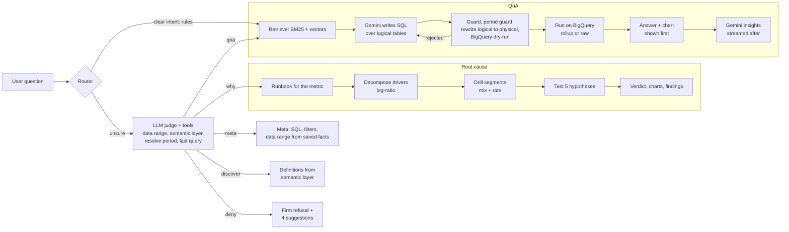

# PANDA AI

**PANDA** = **P**rompt-driven **A**nalytics & **N**atural **D**ata **A**ccess

Ask your data in plain English and get an answer you can trust: the number, a chart, the exact SQL behind it, and, when a metric moves, a root-cause analysis that says *why*.

Built for the **Google AI Builder Cup** (theme: *Future of Work & Enterprise Productivity*) and hosted entirely on Google Cloud.

| | |
|---|---|
| Live prototype | _add the deployed web URL here_ (sign in with any Google account) |

> All code, data and semantic files are original and synthetic ("Acme Retail"). Nothing here derives from any employer system.

---

## The problem

Business teams wait days for an analyst to answer "what happened, and why?". Generic "chat with your data" tools shorten the wait but let the model decide what a metric means, so the same question can return different numbers and nobody can audit them. Finance will not trust an answer it cannot trace.

## What PANDA AI does

| You ask | PANDA AI does |
|---|---|
| "Net GMV by zone for the last 7 days" | Retrieves the governed metric and dimensions, has **Gemini write SQL over logical tables**, validates and rewrites it, dry-runs it, runs it on BigQuery and returns KPI, chart, table and SQL card |
| "Why did Net GMV drop in the last 14 days?" | Runs a **root-cause runbook**: exact driver decomposition, segment drill-down, five hypotheses tested with evidence, preflight data checks. Gemini only narrates computed facts |
| "Show me the SQL" / "till when do you have data?" | Answers from the previous turn's saved facts and the warehouse date range. No new query, no model call |
| "What is BU visits?" | Explains it from the semantic layer |
| "Tell me a joke" / "do you have returns data?" | An **LLM judge with tools** checks the semantic layer and data range, then denies firmly and offers clickable examples |

## Flow



Every answer streams over **AG-UI** (SSE) and renders as an **A2UI** surface with Vega-Lite charts.

## Highlights

- **Governed text-to-SQL.** Metrics, dimensions, glossary and example queries live in markdown + YAML in git. The model only sees logical tables; a sqlglot guard allows read-only SQL over known columns, a rewriter maps to rollup or raw tables, BigQuery dry-run catches the rest, and a bounded repair loop feeds errors back.
- **Explainable root cause.** Log-ratio (LMDI) decomposition of the metric into its drivers, Kitagawa mix/rate drill into segments, runbook hypotheses (metric shift, divergence, concentration, mix shift), polarity-aware verdict (a rising cancellation rate is bad).
- **LLM judge with tools, not a fixed flow.** Rules route clear questions with no model call; ambiguous ones go to a bounded tool-calling judge (max 3 model turns) that checks facts before it routes or denies.
- **No hallucinated dates.** Periods come from a deterministic extractor against the loaded data; SQL that covers the wrong period is rejected and repaired; periods outside the data are refused with the real range. A nightly job rolls the synthetic data forward.
- **Fast and cheap.** One model call per data question, results shown before insights, two-layer semantic cache (plan and result), parallel RCA queries, model timeouts and a concurrency cap, scale-to-zero Cloud Run.
- **Production guardrails.** Firebase ID-token auth, per-user and global daily quotas, per-IP rate limit, byte caps, budget kill-switch, chat history per user, thumbs-up/down feedback stored for a future adaptive loop.

## Why not just use a public offering?

| | Generic chat-with-data / BI copilots | PANDA AI |
|---|---|---|
| Metric definitions | Inferred by the model per question | Governed, versioned in git, validated at startup |
| Trust | "Looks right" | Every answer shows SQL, period, source tables, bytes scanned |
| "Why did it move?" | A narrative the model improvises | Exact decomposition and tested hypotheses; the model only narrates |
| Unknown metric / wrong dates | Often answers anyway | Checks the semantic layer and data range, denies firmly |
| Cost control | Opaque | One call per question, cache, quotas, byte caps, kill-switch |
| UI contract | Proprietary | Open AG-UI + A2UI + Vega-Lite |
| Your data and rules | Hard to adapt | Add a metric or runbook by adding a markdown file |

## Unique selling points

1. Guarded text-to-SQL over a governed semantic layer (guard, rewriter, dry-run, repair).
2. Code-driven, explainable RCA with runbooks.
3. A tool-using LLM judge that grounds routing and refusals in facts.
4. Open, portable UI protocols (AG-UI, A2UI, Vega-Lite).
5. Built to be operated cheaply: about Rs 5,000-10,000 per month target, hard limits everywhere.

## Tech stack

**Google Cloud**

| Service | Used for |
|---|---|
| **Cloud Run** (web, api, jobs) | Next.js BFF, FastAPI + LangGraph agents, bootstrap/refresh jobs. Scale to zero |
| **Firebase Authentication** | Google sign-in; the API verifies ID tokens |
| **Vertex AI (Agent Platform)** | Gemini for the judge, SQL generation and insights; `gemini-embedding-2` for the semantic index |
| **AlloyDB for PostgreSQL + pgvector** | Semantic index, LangGraph checkpoints, semantic cache, chat history, feedback, quotas |
| **BigQuery** | Synthetic 20M-order dataset, rollups + raw tables, byte-capped queries |
| **Secret Manager, Cloud Scheduler, Cloud Build, Artifact Registry, Budgets** | Secrets, nightly refresh, images, spend control and kill-switch |

**Application:** Python 3.12, FastAPI, pydantic, LangGraph, sqlglot, DuckDB (local), Next.js 15 / React, Vega-Lite. **Protocols:** AG-UI over SSE, A2UI surfaces.

## Quick start (local, offline)

Requirements: Python 3.12, Node 20+. No cloud account needed: the default profile uses DuckDB and an offline mock model.

```bash
make setup     # venv + npm install
make data      # 20M synthetic orders into backend/data/panda.duckdb (ARGS="--rows 2000000" for smaller)
make api       # gateway on http://localhost:8000
make web       # UI on http://localhost:3000 (second terminal)
make test      # backend tests
```

Try: "Net GMV by zone last 7 days", "Why did Net GMV drop in the last 14 days?", "show me the sql", "till when do you have data?", "what is BU visits?", "tell me a joke".

Use a real model locally: copy `.env.example` to `.env`, set `LLM_PROVIDER=gemini` and your Vertex or API-key settings (see [docs/CONFIGURATION.md](docs/CONFIGURATION.md)). Terminal trace of one turn: `make ask Q="why did visits drop?" DEBUG=1`.

## Deploy to Google Cloud

Scripts in `deploy/` (run where `gcloud` is logged in); full guide in [docs/GCP_SETUP.md](docs/GCP_SETUP.md).

```bash
cp deploy/env.example.sh deploy/env.sh   # fill in project, region, Firebase web config
make gcp-setup gcp-build gcp-deploy
make gcp-bootstrap STEP=all              # load BigQuery, index AlloyDB, warm the cache
make gcp-refresh CMD=create DAYS=30      # optional nightly data roll-forward
make gcp-diagnose                        # dependency self-check inside the VPC
```

## Repository layout

```
semantic/    Governed layer: metrics, dimensions, tables, glossary, examples, rca/{trees,checks,policies}
backend/     app/ (core, semantic, search, llm, prompts, engines, query, cache, rca, agents, history, security, presentation, api), scripts/, tests/
frontend/    Next.js UI + BFF (AG-UI client, A2UI renderer, Firebase auth)
deploy/      gcloud scripts, Cloud Build files, budget kill-switch
config/      profiles (local, prod)
docs/        ARCHITECTURE, CONFIGURATION, GCP_SETUP, DEBUGGING, FRONTEND_GUIDE
AGENTS.md    Orientation for coding agents and new contributors
```

## Future scope

- **StarRocks for rollups, BigQuery for raw drill-through:** sub-second serving of rolled-up data with BigQuery as the system of record for row-level drill-down.
- **Smarter semantic cache:** embedding-similarity matching and data-version invalidation.
- **GraphRAG on the semantic layer:** relationships between metrics, dimensions and runbooks from OKF files for richer retrieval.
- **RCA through connectors:** read Confluence pages, mail and log files as evidence for hypotheses.
- **Gemma with SFT for RCA:** fine-tune on RCA traces for cheaper, faster, privately deployable inference.
- **Adaptive loop and cross-runbook RCA:** turn thumbs feedback into reviewed examples and glossary fixes; follow the top driver into its own runbook.

## Known limits

Synthetic data only. Model quality depends on the Gemini version configured. Real-model accuracy is graded with `LLM_PROVIDER=gemini make bench`; the offline benchmark only validates the harness. Not load tested.

## License

Apache-2.0. See `LICENSE`.
