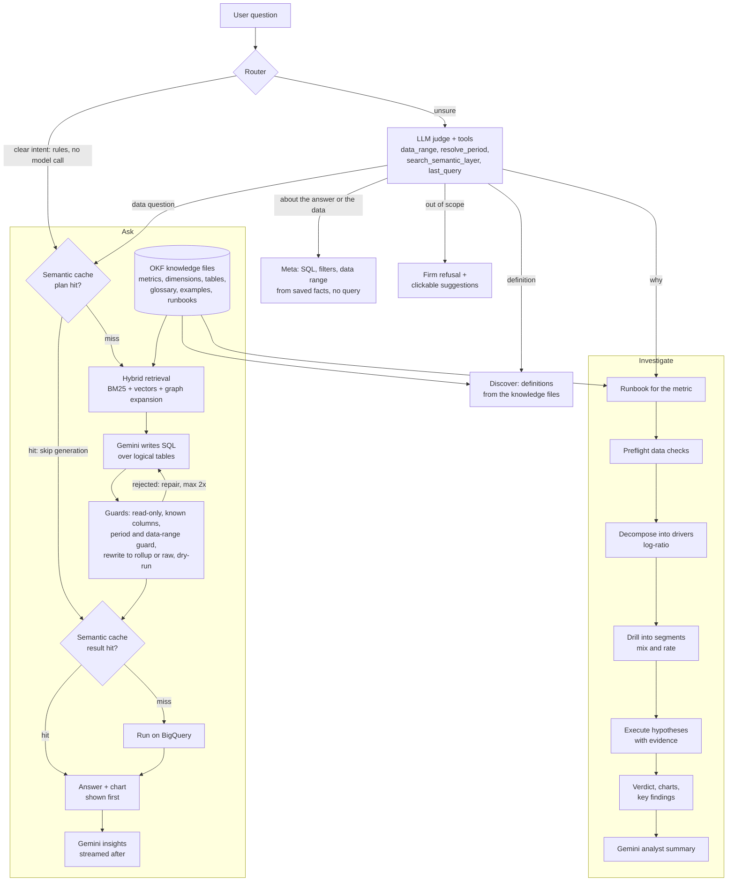

<h1 align="center">🐼 PANDA AI</h1>

<p align="center"><b>P</b>rompt-driven <b>A</b>nalytics &amp; <b>N</b>atural <b>D</b>ata <b>A</b>ccess</p>

<p align="center">Ask your data in plain English and get an answer you can trust: the number, a chart, the exact SQL behind it and, when a metric moves, a root-cause analysis that says <i>why</i>.</p>

> All code, data and knowledge files in this repository are original and synthetic ("Acme Retail").

---

## The problem

A business team asks the analytics team: *"Why did sales drop last week?"*

The analyst writes a query, checks it, tweaks a filter, tries another cut, runs it again. After a dozen trial-and-error queries, an answer comes back as a screenshot or a spreadsheet. A second analyst, asked the same question, picks a different date window or a different meaning of "net", and returns a different number. The business cannot tell which one to trust, so it asks again.

| | Today: ticket to the analytics team | With PANDA AI |
|---|---|---|
| Time to an answer | hours to **1-3 days** (queue, build, review) | **seconds** (a cache hit is about 10 ms) |
| Queries behind one question | **5-15** exploratory queries by trial and error | **1** governed query; a fixed runbook for "why" |
| Root cause of a metric move | **1-2 days** of manual slicing | **seconds to a minute**, evidence attached |
| Same question, same number? | depends on the analyst | yes: one governed definition |
| Can you audit it? | a screenshot | SQL, period, source tables and bytes scanned on every answer |
| Analyst time | e.g. 100 ad-hoc requests a week x 2 h = **~200 analyst-hours a week** | analysts keep the new and hard questions |

*The "Today" column is an illustrative assumption for a typical enterprise: replace it with your own numbers. PANDA AI timings come from our probe runs against a deployed instance (warehouse step 0.4-0.7 s, cache hit about 10 ms).*

## What PANDA AI does

| | You ask | PANDA AI does |
|---|---|---|
| **Ask** | "Net GMV by zone for the last 7 days" | Retrieves the governed metric and dimensions, has **Gemini write SQL over logical tables**, validates and rewrites it, dry-runs it, runs it on BigQuery and returns KPI, chart, table and a SQL card |
| **Investigate** | "Why did Net GMV drop in the last 14 days?" | Runs a **root-cause runbook**: exact driver decomposition, segment drill-down, hypotheses executed against the data with evidence, preflight data checks. The model only narrates computed facts |
| **Discover** | "What is BU visits?" | Explains metrics, dimensions and terms from the knowledge files |

Side kicks: "show me the SQL", "which period did you use?" and "till when do you have data?" answer from the previous turn's saved facts, with no new query. Out-of-scope requests ("tell me a joke", "do you have returns data?") are checked by an LLM judge with tools, then refused firmly with clickable suggestions.

## Flow



Every answer streams over **AG-UI** (SSE) and renders as an **A2UI** surface with Vega-Lite charts.

## Knowledge files (OKF format)

The semantic layer is a folder of plain markdown files with YAML frontmatter, in the OKF format. Each file is one typed node: a metric, a dimension, a table, a glossary term, an example question with its SQL, or an RCA runbook.

```markdown
---
kind: metric
id: net_gmv
title: Net GMV
aliases: [net sales, net revenue, GMV, revenue]
description: Value of orders that were fulfilled (gross GMV minus cancellations).
table: sales
expr: SUM(net_gmv)
format: currency
direction: up_is_good
dimensions: [marketplace, business_unit, zone, region, state, city]
time_grains: [day, week, month]
---
Primary top-line metric. Net GMV = Visits x Conversion x Gross AOV x Net-to-Gross ratio.
```

**Why OKF**
- **Governed and reviewable:** definitions live in git, change through pull requests and are validated at startup (a bad reference fails fast).
- **Business-owned:** a new metric or runbook is a markdown file, not code.
- **Graph-native:** every file references other files by id (metric to table and dimensions, runbook to metric and checks). Those references already drive graph expansion in retrieval, and they are exactly the edges a GraphRAG index needs, so graph-based retrieval is a natural extension rather than a rebuild.
- **Portable:** to adapt PANDA AI to another business or data platform, swap the knowledge files and the engine; the agents, guards and UI stay the same.

## Highlights

- **Governed text-to-SQL.** The model only sees logical tables. A sqlglot guard allows read-only SQL over known columns, a rewriter maps to rollup or raw tables, a warehouse dry-run catches the rest, and a bounded repair loop feeds errors back.
- **Explainable root cause.** Log-ratio (LMDI) decomposition into drivers, Kitagawa mix and rate drill into segments, runbook hypotheses (metric shift, divergence, concentration, mix shift), and a polarity-aware verdict (a rising cancellation rate is bad).
- **An LLM judge with tools, not a fixed flow.** Rules route clear questions with no model call; ambiguous ones go to a bounded tool-calling judge (at most 3 model turns) that checks facts before it routes or refuses.
- **No hallucinated dates.** Periods come from a deterministic extractor against the loaded data; SQL covering the wrong period is rejected and repaired; periods outside the data are refused with the real range.
- **Fast and cheap.** One model call per data question, results shown before insights, a two-layer semantic cache (plan and result), parallel RCA queries, model timeouts and a concurrency cap, scale-to-zero hosting.
- **Operable.** Firebase ID-token auth, per-user and global daily quotas, per-IP rate limits, byte caps, a budget kill-switch, per-user chat history and thumbs up/down feedback stored for a future adaptive loop.

## Accuracy and grounding

**What keeps answers grounded**

| Risk | Control |
|---|---|
| Model invents a metric or column | It only sees governed logical tables; the guard rejects unknown tables and columns |
| Model writes unsafe or expensive SQL | Read-only AST guard, join and length limits, dry-run, per-query byte cap |
| Wrong or invented dates | Deterministic period extraction; SQL must cover the period named in the question; periods outside the loaded data are refused with the real range |
| Model "does the maths" | All numbers come from the warehouse; RCA maths (decomposition, drill) is code; the model only narrates computed facts |
| Answer cannot be checked | Every answer shows its SQL, period, source tables and bytes scanned |
| Question is not answerable | The judge checks the knowledge files and data range, then refuses instead of guessing |

**How accuracy is measured.** A golden benchmark of 43 questions (values, breakdowns, trends, top-N, ratios, period-over-period, multi-table, follow-ups) lives in `backend/app/golden/golden.yaml`. Each question runs through the full graph, and the returned result set is compared (order and column names ignored, numeric tolerance) with independently written ground-truth SQL on the physical tables. This is *execution accuracy*, the standard text-to-SQL measure: it checks the answer, not the SQL text.

```bash
make bench                                  # offline: validates the harness with the mock model
LLM_PROVIDER=gemini make bench ARGS="-v"    # real model, local warehouse
make gcp-bootstrap STEP=accuracy            # the deployed stack: real Gemini + BigQuery, dates follow the live data window
```

Results are printed per category with latency and the path taken (`text_to_sql`, `ir_fallback`, `cache`). To grow the benchmark, add items to `golden.yaml`: a question (or a multi-turn list) and its ground-truth SQL.

**Limits.** The data is synthetic, and the benchmark covers the question shapes in the golden file, not every possible question. Answer quality depends on the configured Gemini model. The offline mock benchmark only validates the harness. Not load tested.

## Why not just use a public offering?

| | Generic chat-with-data tools and BI copilots | PANDA AI |
|---|---|---|
| Metric definitions | Inferred by the model per question | Governed OKF knowledge files in git, validated at startup |
| Trust | "Looks right" | SQL, period, source tables and bytes on every answer |
| "Why did it move?" | A narrative the model improvises | Exact decomposition and executed hypotheses; the model only narrates |
| Unknown metric or wrong dates | Often answers anyway | Checks knowledge files and data range, refuses firmly |
| Cost control | Opaque | One model call per question, semantic cache, quotas, byte caps, kill-switch |
| UI contract | Proprietary | Open AG-UI + A2UI + Vega-Lite |
| Your data and rules | Hard to adapt | Add a metric or runbook as an OKF markdown file |

## Tech stack

**Google Cloud**

| Service | Used for |
|---|---|
| **Cloud Run** (web, api, jobs) | Next.js BFF, FastAPI + LangGraph agents, bootstrap and refresh jobs. Scale to zero |
| **Firebase Authentication** | Google sign-in; the API verifies ID tokens |
| **Vertex AI (Agent Platform)** | Gemini for the judge, SQL generation and insights; `gemini-embedding-2` for the semantic index |
| **AlloyDB for PostgreSQL + pgvector** | Semantic index, LangGraph checkpoints, semantic cache, chat history, feedback, quotas |
| **BigQuery** | Rollup and raw tables, byte-capped queries |
| **Secret Manager, Cloud Scheduler, Cloud Build, Artifact Registry, Budgets** | Secrets, nightly data refresh, images, spend control and kill-switch |

**Application:** Python 3.12, FastAPI, pydantic, LangGraph, sqlglot, DuckDB (local), Next.js 15 and React, Vega-Lite. **Protocols:** AG-UI over SSE, A2UI surfaces.

## Quick start (local, offline)

Requirements: Python 3.12, Node 20+. No cloud account needed: the default profile uses DuckDB and an offline mock model.

```bash
make setup     # venv + npm install
make data      # 20M synthetic orders into backend/data/panda.duckdb (ARGS="--rows 2000000" for smaller)
make api       # gateway on http://localhost:8000
make web       # UI on http://localhost:3000 (second terminal)
make test      # backend tests
```

Try: "Net GMV by zone last 7 days", "Why did Net GMV drop in the last 14 days?", "show me the sql", "till when do you have data?", "what is BU visits?", "tell me a joke".

To use a real model locally, copy `.env.example` to `.env` and set `LLM_PROVIDER=gemini` with your Vertex AI or API-key settings (see [docs/CONFIGURATION.md](docs/CONFIGURATION.md)). Trace one turn in the terminal: `make ask Q="why did visits drop?" DEBUG=1`.

## Deploy to Google Cloud

Scripts live in `deploy/` (run where `gcloud` is logged in). Full guide: [docs/GCP_SETUP.md](docs/GCP_SETUP.md).

```bash
cp deploy/env.example.sh deploy/env.sh   # fill in project, region, Firebase web config
make gcp-setup gcp-build gcp-deploy
make gcp-bootstrap STEP=all              # load BigQuery, index AlloyDB, warm the cache
make gcp-refresh CMD=create DAYS=30      # optional nightly data roll-forward
make gcp-diagnose                        # dependency self-check inside the VPC
```

## Repository layout

```
semantic/    OKF knowledge files: metrics, dimensions, tables, glossary, examples, rca/{trees,checks,policies}
backend/     app/ (core, semantic, search, llm, prompts, engines, query, cache, rca, agents, history, security, presentation, api), scripts/, tests/
frontend/    Next.js UI + BFF (AG-UI client, A2UI renderer, Firebase auth)
deploy/      gcloud scripts, Cloud Build files, budget kill-switch
config/      profiles (local, prod)
docs/        ARCHITECTURE, CONFIGURATION, GCP_SETUP, DEBUGGING, FRONTEND_GUIDE
AGENTS.md    Orientation for coding agents and new contributors
```

## Future scope

- **StarRocks for rollups, BigQuery for raw drill-through:** sub-second serving of rolled-up data, with BigQuery as the system of record for row-level drill-down and for real-time data landing in BigQuery.
- **Smarter semantic cache:** embedding-similarity matching and data-version invalidation.
- **GraphRAG on the OKF knowledge files:** use the existing references between metrics, dimensions, tables and runbooks as graph edges for richer retrieval.
- **RCA through connectors:** read Confluence pages, mail and log files as evidence for hypotheses.
- **Gemma with SFT for RCA:** fine-tune on RCA traces for cheaper, faster, privately deployable inference.
- **Adaptive loop and cross-runbook RCA:** turn thumbs feedback into reviewed examples and glossary fixes; follow the top driver into its own runbook.

## License

Apache-2.0. See `LICENSE`.
