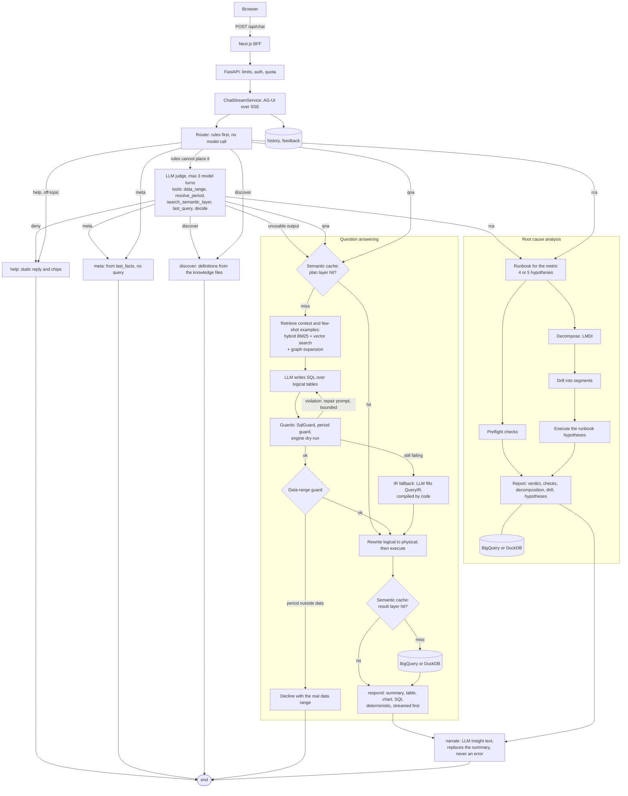
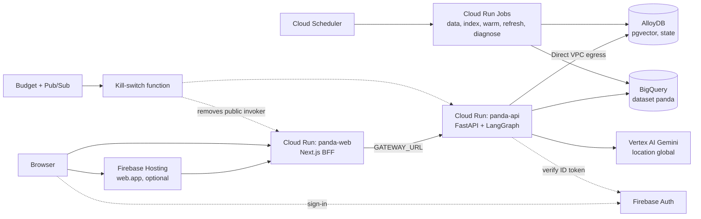

# PANDA architecture

PANDA answers natural-language analytics questions over a governed semantic layer. The model writes SQL over *logical* tables only; code validates, rewrites, dry-runs and executes it. Root-cause questions run a deterministic investigation and the model only narrates.

## Turn flow

The graph is built in `agents/graph.py` (`NODE_CLASSES`, conditional edges). Per-turn state is `TurnState` (`agents/state.py`); `RouterNode` clears per-turn fields via `TURN_RESET`. Only `last_ir`, `last_sql` and `last_facts` carry over for follow-ups. State stays JSON-serialisable.

## Knowledge files (OKF format)

The governed layer lives in `semantic/` as OKF-format markdown knowledge files: markdown with YAML frontmatter. Each entity (metric, dimension, table, glossary term, example, RCA runbook) is a typed node with explicit references to other nodes (a metric names its table and dimensions; a runbook names its metric, drivers and checks). References are validated at startup, so a dangling one fails fast. The same references already drive graph expansion in retrieval ((Retrieval)), which makes GraphRAG a natural extension.

## Data and the semantic layer

Synthetic Acme Retail data (`bootstrap/datagen.py`, seeded, 20M orders by default):

| Table | Grain | Purpose |
|---|---|---|
| `fact_sales` | one row per order | raw facts; the only table with city |
| `agg_sales_daily` | day x marketplace x business unit x zone x region x state | rollup for most questions |
| `agg_traffic_city_daily` / `agg_traffic_state_daily` | day x marketplace x location | visits and orders (raw city / rollup state) |
| `agg_bu_traffic_daily` | day x marketplace x business unit x state | BU visits |

Three anomalies are planted in the last 14 days, one per RCA story: cancellation spike (Express x South), visit-tracking loss (Mall x East, orders unchanged), business-unit mix shift to Grocery (Wholesale x North).

The semantic layer is `semantic/**/*.md` (YAML frontmatter + markdown), loaded by `semantic/loader.py` into typed specs (`semantic/models.py`). `Catalog.validate_references()` fails startup on any dangling reference.

| Kind | Defines |
|---|---|
| `metric` | expression or numerator/denominator (ratios are ratios of sums), table, dimensions, format, polarity (`direction`) |
| `dimension` | column, values, hierarchy |
| `table` | raw table, rollup, time column, rollup dimensions, `anchor` flag |
| `glossary` | business terms |
| `example` | question to SQL few-shots |
| `rca_tree`, `rca_check`, `rca_policy` | one runbook per metric, preflight checks, thresholds |

## Retrieval

`search/hybrid.py` fuses a lexical ranking and a vector ranking with reciprocal rank fusion (score = sum of 1/(60 + rank)), then expands the graph: a hit metric pulls in the dimensions it allows.

| Backend | Lexical | Vector | Used when |
|---|---|---|---|
| `MemoryBackend` | BM25 (`search/memory.py`) | in-memory cosine | `search_backend: memory` |
| `PgVectorBackend` | `tsvector` + `ts_rank` | pgvector `<=>` | `search_backend: pgvector`; index built by `make ingest` / the index job |

Embeddings: `HashEmbedder` offline, `GeminiEmbedder` with a real provider (`embedding_provider`). If an embedding call keeps failing a turn degrades to lexical-only search.

## Routing

`RouterNode` (`agents/nodes/router.py`, rules in `agents/routing.py`):

1. **Rules first** (no model call): help, meta cues (show SQL, which period, data range), injection/off-topic, RCA cues, discover cues, data tokens or known metric/dimension names.
2. **Judge** (`agents/judge.py`) only for what the rules cannot place. An LLM with read-only tools (`agents/tools.py`): `data_range`, `resolve_period`, `search_semantic_layer`, `last_query`, and `decide` (routes: qna, rca, discover, meta, deny). Bounded to 3 model turns; the last turn can only `decide`. A deny carries a short firm reply shown by the help node. Unusable output falls back to the planner (qna); an unavailable model service is reported to the user.
3. **Meta node** (`nodes/meta.py`): "show the SQL", "which filters/period", "till when do you have data" answered from `last_facts` and the warehouse date range. No query, no model.
4. **Help node** (`nodes/help.py`): static intro or refusal plus curated suggestion chips. Refusals never depend on a model.
5. **Discover node**: definitions and what exists, from the semantic layer.

## SQL planner and query pipeline

`SqlPlannerNode` (`nodes/planner.py`):

1. Plan-cache lookup. Key = question + data anchor date + previous SQL, so plans with explicit dates are never reused across data refreshes.
2. Retrieve governed context and few-shot examples.
3. One model call returns `{sql, rationale, confidence}` over logical tables (`query/logical.py`). Empty SQL means "declined": a fixed friendly message.
4. `LogicalGuard` / `SqlGuard` (sqlglot AST, `query/guard.py`): one SELECT/WITH, known tables and columns, no `SELECT *`, function allowlist, join cap, size and row cap.
5. `SqlNormalizer` derives a canonical intent (metrics, dimensions, filters, resolved dates, grain) from the SQL: cache keys, follow-ups, RCA.
6. **Period guard**: if the question names a period (`extract_time_expr`), the SQL must cover exactly it (skipped for comparisons).
7. `LogicalRewriter` maps each logical table to its rollup if every referenced dimension is in `rollup_dimensions`, else raw.
8. Engine **dry-run** (BigQuery bytes, DuckDB EXPLAIN). Any guard, period or dry-run failure goes back to the model as a repair prompt, at most `sql_max_repairs` (2) times and never beyond `llm_max_calls_per_turn`.
9. **Data-range guard**: a period wholly outside the loaded data is declined with the real range.
10. Still failing: `ir_fallback` has the model fill a `QueryIR`, compiled deterministically by `query/compiler.py`.

`meta.path` is `text_to_sql`, `ir_fallback` or `cache`. `ExecutorNode` runs the physical SQL through the result-layer cache (`cache/semantic_cache.py`, keyed on the normalised intent plus anchor, so equivalent questions share an entry). Engines: `DuckDBEngine` (timeout via cursor interrupt) and `BigQueryEngine` (translates DuckDB SQL, `SAFE_DIVIDE`, Monday-start weeks, `maximum_bytes_billed`, query label `app=panda-ai`).

Time is relative to the dataset **anchor** (latest loaded date), half-open `[start, end)`. The anchor is cached with a 60 s TTL (`LazyPeriodResolver`) so running instances follow the nightly refresh without a restart; a failed re-read keeps the last known anchor.

## Responder and narration

`ResponderNode` builds the answer immediately and deterministically: summary text, table, chart spec, SQL, provenance, and saves `last_facts`. `NarrateNode` then asks the model for insight text (12 s, no retries) and replaces the summary; skipped for single-figure answers; cached. It can never replace a good response with an error. The stream therefore sends the result twice: first the standard summary, later the same result with `meta.narrated=true` (the UI replaces the first; `TEXT_MESSAGE_START` resets text).

## RCA (`rca/`)

`RcaInvestigator.investigate(metric, period)` runs the metric's runbook (`semantic/rca/trees`, one per metric: Net GMV, visits, conversion rate, ASP). Every number is computed; warehouse reads run concurrently (memoised `SegmentReader`); no model call precedes the investigation.

| Step | Method |
|---|---|
| Preflight (`checks.py`) | `FreshnessCheck`, `MetricShiftCheck`; fired checks annotate, never abort |
| Decompose (`LogRatioDecomposer`) | exact multiplicative attribution (LMDI) of the change across drivers |
| Drill (`SegmentDriller`) | additive metrics: value change; ratio metrics: mix and rate effects (Kitagawa) |
| Hypotheses (`hypotheses.py`) | four Strategy test types: `metric_shift`, `divergence`, `concentration`, `mix_shift`; up to five hypotheses per runbook, thresholds in the runbook file |
| Verdict | polarity-aware: the metric's `direction` (`up_is_good` / `down_is_good`) decides which way is bad in tone and header |

Add a hypothesis type: subclass `HypothesisTester`, register in `TESTERS`, add to `HypothesisTest`. Add a runbook: one markdown file.

## Wire contracts and UI surfaces

- **AG-UI** (`schemas/agui.py`, `api/sse.py`): `RUN_STARTED`, `STEP_STARTED/FINISHED`, `TEXT_MESSAGE_*`, `ACTIVITY_SNAPSHOT` (`a2ui-surface`), `CUSTOM panda.step` / `panda.result`, `RUN_FINISHED`, `RUN_ERROR`. Heartbeat comments every 15 s.
- **A2UI** (`presentation/a2ui.py`, catalog `a2ui_catalog.json`, copied to `frontend/components/a2ui/catalog.json`; keep in sync). Components: Column, Grid, Heading, Text, BulletList, Callouts, KpiRow, VerdictHeader, VegaLiteChart, DataTable, HypothesisList, DecompositionTable, SegmentBars, ChipRow, SuggestionChips, SqlBlock. The `ChatResult` is also sent whole as `panda.result`; the UI falls back to it if no surface renders.
- `schemas/chat.py`, `rca/models.py` and `frontend/lib/types.ts` change together.

## Accuracy and grounding

**Grounded:** metric and dimension definitions come from the knowledge files, not from the model's memory. SQL passes `SqlGuard` (allowlisted tables, columns and functions), the period guard (the SQL must cover the period named in the question), the data-range guard and an engine dry-run before it runs. Every number is computed by the warehouse or by code (RCA decomposition, drill and hypotheses are deterministic). The model writes SQL and narrates; it never supplies figures.

**Measured:** the golden benchmark (`backend/app/golden/golden.yaml`, `make bench`) runs questions through the full graph; `LLM_PROVIDER=gemini make bench` grades a real model. On the deployed stack, `python -m app.bootstrap accuracy` runs the same questions against the real services. Execution accuracy: the result set of the answered query equals the result set of the ground-truth SQL on physical tables. With the mock LLM the benchmark validates the harness only.

**Limits:** accuracy depends on the model and on how well the knowledge files cover the question; a model can choose a plausible but wrong metric or filter that passes every guard. Narration is free text and is not verified against the data beyond the figures it receives. The benchmark is small and synthetic. Guards reduce, not remove, wrong answers; the generated SQL is shown with every answer so it can be checked.

## API, history, feedback

| Endpoint | Role |
|---|---|
| `POST /api/chat` | SSE turn (`ChatStreamService` runs the graph in a worker thread, forwards events, heartbeats, detects disconnect) |
| `GET /api/threads`, `GET|DELETE /api/threads/{id}` | the caller's own history (`history/store.py`) |
| `POST /api/feedback`, `GET /api/threads/{id}/feedback` | thumbs, reasons, comment (`history/feedback.py`) |
| `GET /api/me`, `/api/meta`, `/api/a2ui/catalog` | quota, runtime info, catalog |
| `/api/admin/*` | cache clear and stats, diagnostics (admins only in firebase mode) |
| `/health`, `/ready` | liveness; readiness (503 until warehouse tables exist) |

Tables (Postgres): `panda_threads`, `panda_turns` (per user, 30 days, 50 chats, 60 turns each), `panda_feedback` (rating, reasons, comment, route, path, SQL, truncated answer; recorded only, never read back into the model), `panda_cache`, `panda_usage`, `semantic_docs`, LangGraph `checkpoints*`. In-memory stores are used locally. History and feedback are best effort and never fail a turn.

**Security chain on `POST /api/chat`:** body-size limit, per-IP token bucket, Firebase ID-token verification (`auth_mode: firebase`), per-user and global daily quota, then the per-turn LLM-call budget (`llm/budget.py`). Failed auth or quota never reaches the model. Admin emails are exempt from the per-user cap.

## Latency design

- Q&A: rules route (no model), ONE model call writes SQL, data streams, optional narration follows.
- Model calls are bounded: `llm_timeout_s` 25, `llm_max_retries` 1, `llm_max_concurrency` 6 per instance, narration 12 s. Provider error text goes to logs and `details`, never to users.
- Plan and result caches cut repeats to near zero; `cache_ttl_s` is 86400 in prod (keys carry the anchor, so a refresh invalidates implicitly).
- Scale: one instance serves many SSE connections, but each turn holds a worker thread; not load tested. State lives in Postgres, so instances are stateless.

## Nightly refresh

Cloud Scheduler triggers the Cloud Run Job `panda-bootstrap-refresh` (`python -m app.bootstrap refresh --until <date>`): regenerate data ending yesterday (UTC), reload BigQuery, clear the cache, prune idle conversation state, re-warm the cache. It no-ops after its stop date. Running API instances pick up the new anchor within 60 s.

## GCP deployment

Details and commands: `docs/GCP_SETUP.md`. Component choices are explicit enums (`docs/CONFIGURATION.md`); `app_env: prod` refuses to start unless the whole production suite is selected.

## Extension points

| Pattern | Where | Extend by |
|---|---|---|
| Ports and adapters | `engines/base.py`, `llm/base.py`, `search/base.py` | implement the port, register in the factory |
| Strategy | `rca/hypotheses.py`, `rca/checks.py` | add a class, register it |
| Template Method | `agents/base.py` | new node: subclass `AgentNode`, implement `run`, add to `NODE_CLASSES`, register its prompt in `prompts/registry.py` |
| Composition root + DI | `container.py`, `NodeDependencies` | nodes never import singletons |
| Enums over strings | `core/enums.py` | every cross-module string |
| Error taxonomy | `core/errors.py` | `PandaError` subclasses; `user_facing` decides what users see |
